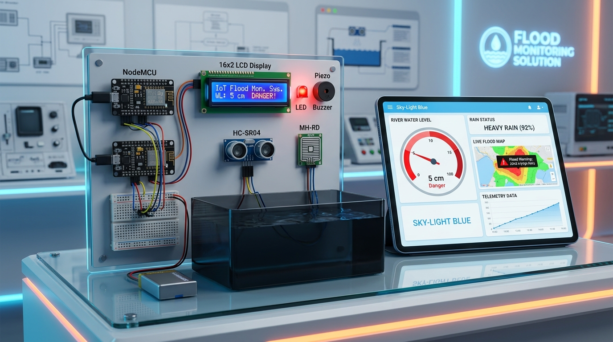

# 🌊 Flood Monitoring System (IoT + Web Application)

> **Developed with Love (🏴‍☠️ Pirate Animated Pulse Icon) by Team Pirates**  
> *Deployable on Render | Microcontroller: ESP8266 NodeMCU | Timezone: Asia/Kolkata (+5:30)*  
> *Reference Standard:* [Central Water Commission Flood Forecast System (ffs.india-water.gov.in)](https://ffs.india-water.gov.in/#/)

---

## 📸 AI Solution Showcase



*Photorealistic AI visualization of the implemented hardware solution showing the NodeMCU ESP8266, HC-SR04 ultrasonic water depth sensor, MH-RD raindrop sensor, I2C 16x2 LCD screen, alert buzzer, warning LED, and the Sky-Light Blue web dashboard.*

---

## 🛠️ IoT Hardware Details

| Component | Model / Spec | NodeMCU Pin | GPIO | Function |
| :--- | :--- | :--- | :--- | :--- |
| **Microcontroller** | NodeMCU ESP8266 (CP2102) | - | - | Core telemetry & WiFi client |
| **Ultrasonic Sensor** | HC-SR04 | **Trig: D5**, **Echo: D6** | GPIO 14, GPIO 12 | Real-time water level sensing in cm |
| **Raindrop Sensor** | MH-RD Module | **D7** | GPIO 13 | Digital rain detection (Yes / No) |
| **I2C LCD Display** | 16x2 Character LCD (@0x27) | **SCL: D1**, **SDA: D2** | GPIO 5, GPIO 4 | Local status & alert messaging |
| **Buzzer** | Active/Piezo Sounder | **D3** | GPIO 0 | Audible danger alarm beeper |
| **Alert LED** | High-Brightness Red LED | **D0** | GPIO 16 | Visual alert indicator |

### 🎯 3 Safety Threshold Values
1. **Safe Level (`<= 15 cm`)**: Normal river/drainage level. Status: **Safe**, Green badge, Buzzer OFF, LED OFF.
2. **Warning Level (`16 cm - 25 cm`)**: Moderate surge. Status: **Warning**, Amber badge, LED standby.
3. **Danger Level (`> 25 cm`)**: Critical flood crest! Status: **Danger**, Red Alert, Buzzer beeps on hardware + web audio, Danger signs pop on Web & LCD.

### 📶 WiFi & Location Configuration
- **WiFi Name (SSID)**: `ESP8266`
- **Password**: `12345678`
- **Location Details**: `Latitude & Longitude` kept blank in code for user personalization (`const char* LATITUDE = ""; const char* LONGITUDE = "";`).
- **Render URL**: Kept blank for user post-deployment configuration (`const char* RENDER_URL = "";`).

### 📟 Hardware LCD Sequence
- **In Setup**:
  1. Row 1: `MyProject` | Row 2: `WELCOME` (`delay(3000)`)
  2. Row 1: `CONNECTING TO` | Row 2: `WiFi.........`
  3. Row 1: `CONNECTED TO` | Row 2: `WiFi...SUCCESS`
- **In Loop**:
  - Telemetry sent to server every 10 seconds.
  - Server details fetched and cycled on LCD:
    - R1: `Flood Monitoring` | R2: `System` (`delay(2s)`)
    - R1: `WaterLevel` | R2: `5 cm.` (`delay(2s)`)
    - R1: `Status` | R2: `Danger` / `Safe` / `Warning` (`delay(2s)`)
  - If Danger spotted: `! DANGER ALERT !` pops on LCD and hardware buzzer beeps!

---

## 💻 Web Application Features

### 🎨 Theme & Layout
- **Theme**: Sky-Light Blue gradient palette (`#0ea5e9`, `#0284c7`, `#001f3f`).
- **Theme Toggle**: One-click **Light/Dark Mode** switch (persisted in `localStorage`).
- **Responsive**: Fully optimized for mobile phones, tablets, and desktop workstations.
- **Footer**: `"Developed with Love(Pirate Animated Pulse Icon) by Team Pirates"` with animated pulsing pirate emblem.

### 🔐 Page 1: Authentication
- **Sign In & Registration**: User accounts stored in JSON database with `bcryptjs` password hashing.
- **Fields**: Name, Email, Password.
- **1-Click Demo Login**: Pre-configured account for **Dharini** (`dharini@floodmonitor.org` / `password123`) for instant evaluation.

### 📊 Page 2: Web Dashboard
- **Header**:
  - App Name: **Flood Monitoring System**
  - Logged In User Greeting: **`Welcome Dharini`** (dynamically reflects user).
  - **ESP8266 ONLINE / OFFLINE Status Badge**: Real-time heartbeat detection (pulsing emerald when active, rose when offline).
  - Web Audio Buzzer Alarm Mute/Unmute toggle.
  - Light/Dark theme toggle & Logout.
- **Tab 1: Live Monitoring & Records**:
  - **Section 1**:
    - Current location of the city where flood is taking place (requests Geolocation permission prior; defaults to Nagpur, Maharashtra).
    - Water level display in large font cards with colorful Seek Bar / Gauge.
    - Danger signs and web audio buzzer beeper when safe level is exceeded.
    - Raindrop sensor status card (`Rainfall: Yes / No`).
    - Real-time Water Level vs Time line graph with safe, warning, and danger threshold reference lines.
  - **Section 2**:
    - City search bar with coordinates matching (checks if searched coordinates match hardware node).
    - **All Saved Records Table (with Pagination)**:
      ```
      # | Water Level | RainFall(Yes or No) | District | Time | Date | Action (Delete)
      1 | 5 cm        | Yes                 | Nagpur   | HH:MM AM | DD-MM-YYYY | Delete
      ```
    - Delete button per record with instant UI update.
    - Correlation Trend Graph under the table (Water Level vs Rainfall distribution).
    - India Central Water Commission citation (`https://ffs.india-water.gov.in/#/`).
- **Tab 2: Telemetry & Actuator Controls**:
  - Virtual 16x2 LCD screen mirroring exact hardware display lines.
  - Custom text sender for LCD Row 1 and Row 2.
  - Remote LED D0 switch (`ON` / `OFF`).
  - Buzzer test beeper.
  - **Manual Testing Simulator**: Slider (1 to 45 cm) and Rain toggle to simulate telemetry for manual testing without physical hardware!
- **Tab 3: Geographic Flood Map**:
  - Interactive Leaflet.js map with color-coded safety pins (Red: Danger, Orange: Warning, Green: Safe).
  - Stations for Nagpur (Nag River), Bhandara (Wainganga), Chandrapur (Wardha/Erai), Wardha, Gadchiroli.
  - River basin information, water depth, and rainfall status.

---

## 🚀 Deployment at Render

### Step 1: Push Project to GitHub
```bash
git init
git add .
git commit -m "feat: complete Flood Monitoring System for Render deployment"
git remote add origin https://github.com/<your-username>/flood-monitoring-system.git
git push -u origin main
```

### Step 2: Create Web Service on Render
1. Go to [Render Dashboard](https://dashboard.render.com/) and click **New + > Web Service**.
2. Connect your GitHub repository.
3. Configure settings:
   - **Name**: `flood-monitoring-system`
   - **Environment**: `Node`
   - **Build Command**: `npm install`
   - **Start Command**: `npm start`
   - **Plan**: `Free`
4. Click **Deploy Web Service**.
5. Once deployed, copy your Render URL (e.g., `https://flood-monitoring-system.onrender.com`).

### Step 3: Configure ESP8266 Code
Open `esp8266/flood_monitoring_esp8266.ino` in Arduino IDE:
1. Paste your deployed Render URL into `RENDER_URL`:
   ```cpp
   const char* RENDER_URL = "https://flood-monitoring-system.onrender.com";
   ```
2. (Optional) Enter your station coordinates:
   ```cpp
   const char* LATITUDE = "21.1458";
   const char* LONGITUDE = "79.0882";
   ```
3. Upload to NodeMCU ESP8266!

---

## 🧪 Local Manual Testing Guide

1. Start the server locally:
   ```bash
   node server.js
   ```
2. Open your browser at `http://localhost:3000`.
3. Click **1-Click Demo Login (Welcome Dharini)**.
4. Go to **Tab 2 (Telemetry & Controls)** and use the **Manual Testing Telemetry Injector**:
   - Slide water level above `25 cm` and click **Send Simulated Telemetry Packet**.
   - Notice the **DANGER ALERT** banner pop up, the Web Audio buzzer sounding, and the status switching to **CRITICAL DANGER**!
   - Slide water level below `15 cm` to see it return to **SAFE**.
5. Go to **Tab 1** to observe the records table pagination, search for `Nagpur` to test coordinate matching, and view the live graphs.
6. Switch between **Light and Dark mode** using the sun/moon icon in the header.

---

## 👥 Credits
**Developed with Love by Team Pirates**
